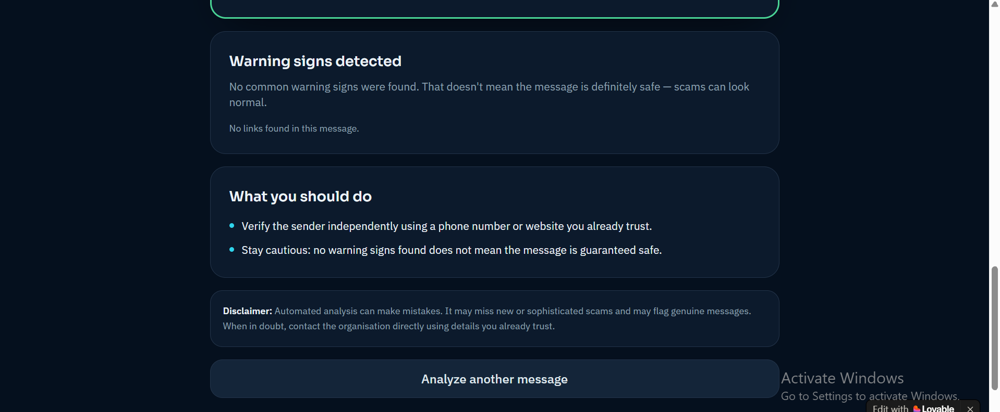
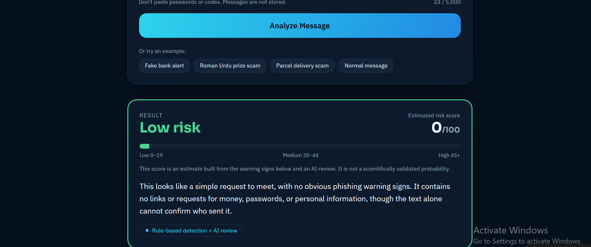
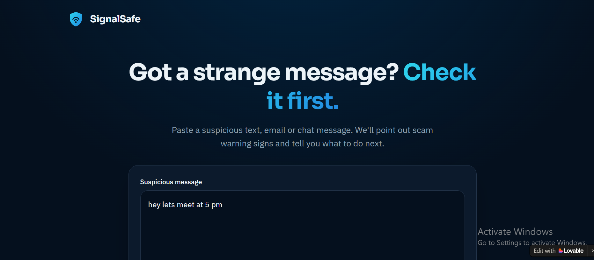

# SignalSafe — Hackathon Project

SignalSafe is a privacy-minded scam/phishing message analysis demo with a polished responsive interface, English + Roman Urdu heuristics, highlighted suspicious phrases, optional AI explanations, and optional Google Web Risk URL lookups.

## Run locally

Requires Python 3.10+.

```bash
python server.py
```

Open http://127.0.0.1:8000 in your browser. No packages are required for the demo.

## Enable AI analysis (optional)

1. Create an API key in your OpenAI developer account.
2. Set the key as an environment variable. Do not put it in the HTML or commit it to source control.

macOS/Linux:
```bash
export OPENAI_API_KEY="your-key"
export OPENAI_MODEL="gpt-4.1-mini"
python server.py
```

Windows PowerShell:
```powershell
$env:OPENAI_API_KEY="your-key"
$env:OPENAI_MODEL="gpt-4.1-mini"
python server.py
```

If no key is set or the AI service is unavailable, the app falls back to rules-based analysis and labels it as demo mode. API usage may cost money.

## Enable live URL threat lookups (optional)

1. Enable the Google Web Risk API for a Google Cloud project and create an API key.
2. Set `GOOGLE_WEBRISK_API_KEY` in the environment before running the server.

macOS/Linux:
```bash
export GOOGLE_WEBRISK_API_KEY="your-key"
python server.py
```

Windows PowerShell:
```powershell
$env:GOOGLE_WEBRISK_API_KEY="your-key"
python server.py
```

The sample performs a Google Web Risk `MALWARE` lookup. Review the provider's current API documentation, supported threat types, billing, quotas, and terms before a public launch. A negative lookup does not guarantee that a URL is safe.

## Included features

- Responsive dark cybersecurity UI
- Message types: SMS, email, social DM, marketplace/payment
- English + Roman Urdu keyword/pattern checks
- Sample messages and demo mode
- Risk indicator, explanations, recommendations
- Highlighting of exact suspicious phrases
- Optional AI-assisted contextual assessment (server-side key)
- Optional Google Web Risk URL reputation lookup
- Clear uncertainty/AI-mistake warning
- Avoids logging submitted message contents in server request logs

## Important limitations / production checklist

- The displayed score is a heuristic risk indicator, not a calibrated probability.
- AI can miss sophisticated scams or flag legitimate messages.
- Pattern-based Urdu/Roman Urdu support is a starter set, not broad language coverage.
- URL reputation checks may not detect new or unlisted threats and currently check the MALWARE category only.
- This local server is a prototype, not hardened for public internet deployment. Before deployment, add HTTPS, authentication/rate limiting, abuse controls, security review, privacy/retention policy, and suitable error monitoring. Do not submit real passwords, OTPs, account numbers, or private conversations.
- AI requests send the pasted message to the configured AI provider. Inform users clearly and get appropriate consent before processing real user data.
- ## 🖼️ Screenshots

The following screenshots showcase SignalSafe's user interface, message analysis process, risk assessment, and scam-detection results.





